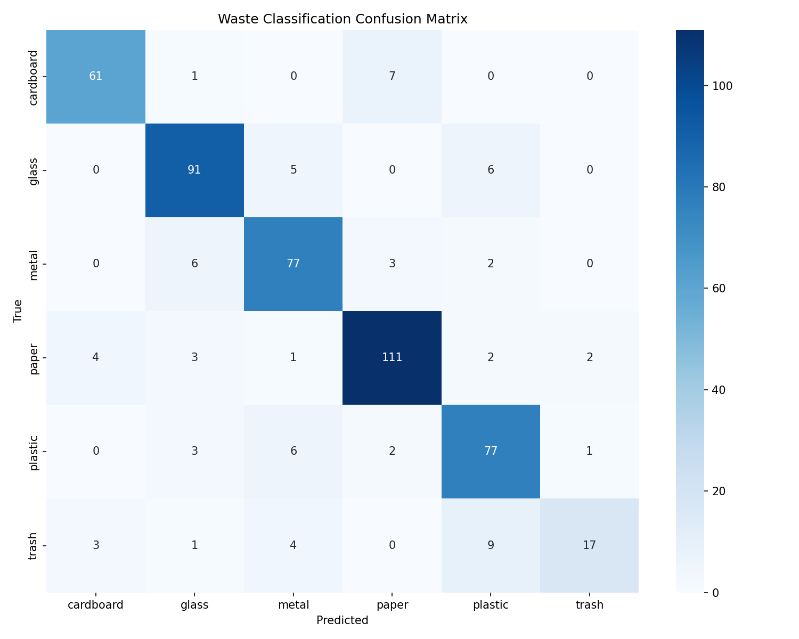
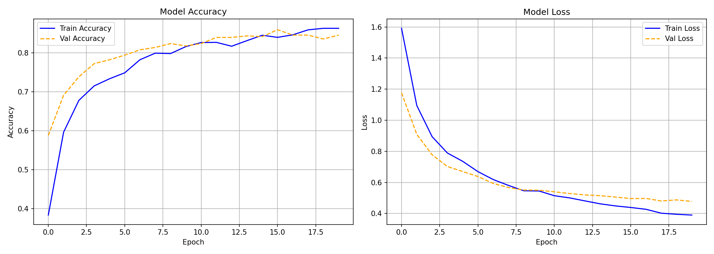
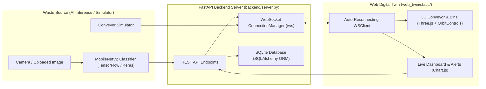

# Smart Waste Sorting Digital Twin

A local, web-based **Digital Twin** for an automated AI-powered waste sorting conveyor system, built for the **Digital Twin Concepts and Applications (DTCA)** course.

The system classifies waste into **6 categories** (`cardboard`, `glass`, `metal`, `paper`, `plastic`, `trash`) using a transfer-learned **MobileNetV2** deep learning model trained on TrashNet, persists sorting telemetry in **SQLite**, and streams real-time updates over **WebSockets** to an interactive **Three.js 3D Digital Twin** and live **Chart.js** analytics dashboard.

---

## Screenshots

> Add screenshots of the live dashboard and model evaluation plots below.

| 3D Digital Twin & Live Dashboard | Model Confusion Matrix |
| :---: | :---: |
| `` *(placeholder)* |  |

| Training & Validation Curves |
| :---: |
|  |

---

## System Architecture



---

## Tech Stack

| Layer | Technology | Purpose |
| :--- | :--- | :--- |
| **AI / Computer Vision** | TensorFlow / Keras, MobileNetV2, OpenCV, Pillow, scikit-learn | 6-class TrashNet waste classification (~85.9% val accuracy) |
| **Backend Server** | FastAPI, Uvicorn | Async REST APIs, static file serving, background simulation |
| **Real-Time Messaging** | WebSockets (`websockets`, FastAPI `WebSocket`) | Live event streaming (`sort_event`, `stats_update`, `bins_update`) |
| **Database** | SQLite, SQLAlchemy ORM | Persistent storage of sort events, bin fill levels, and system logs |
| **3D Digital Twin** | Three.js (r128), OrbitControls | Interactive 3D conveyor belt, moving waste items, diverter gates, and 6 fill-level bins |
| **Analytics Dashboard** | Chart.js 4, Vanilla JavaScript, HTML5/CSS3 | Dark-themed KPI cards, real-time line chart, bin bars, detection feed, and alerts |
| **Testing** | pytest, unittest, httpx | Automated model, database, REST API, and end-to-end tests |

---

## Installation & Quick Start (Windows)

### Prerequisites
- **Windows 10 / 11**
- **Python 3.10+** (verified on Python 3.10–3.14) — ensure `python` and `pip` are on your `PATH`
- **Modern Web Browser** (Google Chrome or Microsoft Edge recommended)

### 1. Clone or Navigate to the Project
```powershell
cd c:\Users\sinha\Downloads\DTCA_proj\Smart_Waste_DT
```

### 2. Install Python Dependencies
```powershell
pip install -r requirements.txt
```

### 3. Download the TrashNet Dataset
Download the **TrashNet** dataset (`dataset-resized.zip`, 2,527 images across 6 classes) from Hugging Face (`garythung/trashnet`) or GitHub (`garythung/trashnet`) and extract the 6 class folders into `ai_model/dataset/`:

```text
ai_model/dataset/
├── cardboard/
├── glass/
├── metal/
├── paper/
├── plastic/
└── trash/
```

See [ai_model/DATASET_README.md](ai_model/DATASET_README.md) for detailed dataset instructions and class counts.

### 4. Train & Evaluate the AI Model
```powershell
python ai_model/train.py
```
This trains MobileNetV2 with transfer learning and saves `ai_model/model.keras`, `ai_model/class_names.json`, and `ai_model/evaluation_results/training_history.png`.

*(Optional)* Evaluate the trained model and generate the confusion matrix and classification report:
```powershell
python ai_model/evaluate.py
```

### 5. Start the Digital Twin Server
```powershell
python backend/server.py
```
*(Alternatively, from the `backend/` folder: `cd backend && python server.py`, or `python -m uvicorn backend.server:app --reload`.)*

### 6. Open the Dashboard
Open your browser and navigate to:
```text
http://localhost:8000
```
Click **▶ Start Simulation** in the top bar to stream live simulated waste sorting events into the 3D scene and analytics dashboard.

### Running Tests
```powershell
pytest tests/test_backend.py -v
python tests/test_model.py -v
```

---

## Project Structure

```text
Smart_Waste_DT/
├── ai_model/
│   ├── dataset/                    # TrashNet images (6 class folders)
│   ├── evaluation_results/
│   │   ├── classification_report.json
│   │   ├── confusion_matrix.png
│   │   └── training_history.png
│   ├── class_names.json            # Saved class label mapping
│   ├── DATASET_README.md           # TrashNet download & structure guide
│   ├── evaluate.py                 # Model metrics & confusion matrix script
│   ├── inference.py                # WasteClassifier inference wrapper
│   ├── model.keras                 # Trained MobileNetV2 model
│   ├── requirements.txt
│   └── train.py                    # Data pipeline & MobileNetV2 training script
├── backend/
│   ├── database.py                 # SQLite CRUD operations & statistics
│   ├── models.py                   # SQLAlchemy models (SortEvent, BinStatus, SystemLog)
│   ├── requirements.txt
│   ├── server.py                   # FastAPI REST + WebSocket server & sim loop
│   └── waste_sorting.db            # Auto-created SQLite database
├── simulation/
│   └── conveyor_sim.py             # Standalone & in-server conveyor simulator
├── web_twin/
│   └── static/
│       ├── css/
│       │   └── style.css           # Dark-theme dashboard styling
│       ├── js/
│       │   ├── dashboard.js        # Chart.js, KPI cards, bin bars, alerts, controls
│       │   ├── twin3d.js           # Three.js 3D conveyor, bins, gates, waste object
│       │   └── websocket.js        # Auto-reconnecting WebSocket client
│       └── index.html              # Dashboard HTML shell
├── tests/
│   ├── test_backend.py             # Database CRUD & FastAPI integration tests
│   ├── test_model.py               # AI model inference tests
│   └── test_e2e.py                 # End-to-end system tests
├── README.md
└── requirements.txt
```

---

## API Documentation

Base URL: `http://localhost:8000` (Interactive OpenAPI docs available at `http://localhost:8000/docs`).

### REST Endpoints

| Method | Endpoint | Description | Example Response |
| :--- | :--- | :--- | :--- |
| `GET` | `/` | Serves the Digital Twin web dashboard (`index.html`) | `200 OK` (HTML) |
| `GET` | `/api/health` | Server health and AI model load status | `{"status": "ok", "model_loaded": true, "timestamp": "..."}` |
| `GET` | `/api/stats` | Aggregated totals, accuracy, 10-min rate, per-class counts, and 30-min trend | `{"total_sorted": 12, "accuracy": 0.9167, "sorting_rate": 1.2, ...}` |
| `GET` | `/api/bins` | Status of all 6 waste bins (`item_count`, `capacity`, `fill_percentage`) | `[{"bin_name": "cardboard", "item_count": 2, "capacity": 50, "fill_percentage": 4.0}, ...]` |
| `GET` | `/api/events?limit=50` | Most recent sort events (newest first) | `[{"id": 12, "detected_class": "glass", "confidence": 0.96, "assigned_bin": "glass", "success": true, ...}]` |
| `POST` | `/api/predict` | Upload a waste image (`multipart/form-data`, field `file`), classify with MobileNetV2, save to DB, and broadcast via WebSocket | `{"event_id": 1, "class": "glass", "confidence": 0.9806, "all_probabilities": {...}}` |
| `POST` | `/api/simulate/start` | Start the background conveyor simulation loop (idempotent) | `{"status": "started"}` |
| `POST` | `/api/simulate/stop` | Stop the background conveyor simulation loop | `{"status": "stopped"}` |
| `POST` | `/api/reset` | Clear all sort events, reset bin counts to `0`, and broadcast empty state | `{"status": "reset"}` |

### WebSocket Endpoint

- **URL:** `ws://localhost:8000/ws`
- **Server → Client Messages:**
  - `init` — Sent immediately upon connection with `{bins, stats}`
  - `sort_event` — Emitted on each classification (`id`, `detected_class`, `confidence`, `assigned_bin`, `success`, `timestamp`)
  - `stats_update` — Updated KPI metrics after each event
  - `bins_update` — Updated fill levels for all 6 bins
- **Client → Server Messages (Standalone Simulator):**
  - `spawn`, `detection`, `sorted`

---

## Future Work

- **MQTT Telemetry Broker:** Stream real-time sensor readings (ultrasonic bin fill sensors, conveyor encoder speed, IR triggers) via MQTT (e.g., Eclipse Mosquitto).
- **OPC-UA Industrial Integration:** Expose conveyor status, diverter states, and KPIs over OPC-UA for compatibility with SCADA/MES factory systems.
- **ESP32 Hardware Integration:** Connect physical servo-actuated diverter gates, an ESP32-CAM or Raspberry Pi camera module, and ultrasonic fill-level sensors for closed-loop hardware-in-the-loop (HIL) synchronization with the 3D Digital Twin.
- **Model Optimization:** Export to ONNX / TensorFlow Lite for edge inference and expand the dataset to address TrashNet class imbalance (`trash` class).

---

## Authors

**DTCA Project — Group 2**
- **Ashutosh Sinha**
- **Saurav Roy**
- **Prithviraj Dhawan**

---

## License

This project is licensed under the **MIT License**. See below for details:

```text
MIT License

Copyright (c) 2026 Ashutosh Sinha, Saurav Roy, Prithviraj Dhawan

Permission is hereby granted, free of charge, to any person obtaining a copy
of this software and associated documentation files (the "Software"), to deal
in the Software without restriction, including without limitation the rights
to use, copy, modify, merge, publish, distribute, sublicense, and/or sell
copies of the Software, and to permit persons to whom the Software is
furnished to do so, subject to the following conditions:

The above copyright notice and this permission notice shall be included in all
copies or substantial portions of the Software.

THE SOFTWARE IS PROVIDED "AS IS", WITHOUT WARRANTY OF ANY KIND, EXPRESS OR
IMPLIED, INCLUDING BUT NOT LIMITED TO THE WARRANTIES OF MERCHANTABILITY,
FITNESS FOR A PARTICULAR PURPOSE AND NONINFRINGEMENT. IN NO EVENT SHALL THE
AUTHORS OR COPYRIGHT HOLDERS BE LIABLE FOR ANY CLAIM, DAMAGES OR OTHER
LIABILITY, WHETHER IN AN ACTION OF CONTRACT, TORT OR OTHERWISE, ARISING FROM,
OUT OF OR IN CONNECTION WITH THE SOFTWARE OR THE USE OR OTHER DEALINGS IN THE
SOFTWARE.
```
